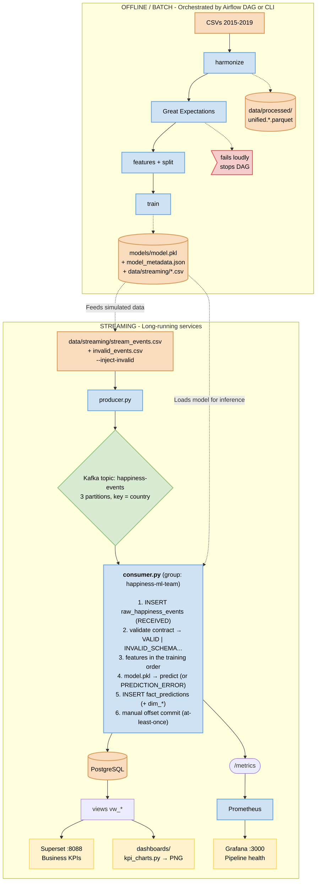
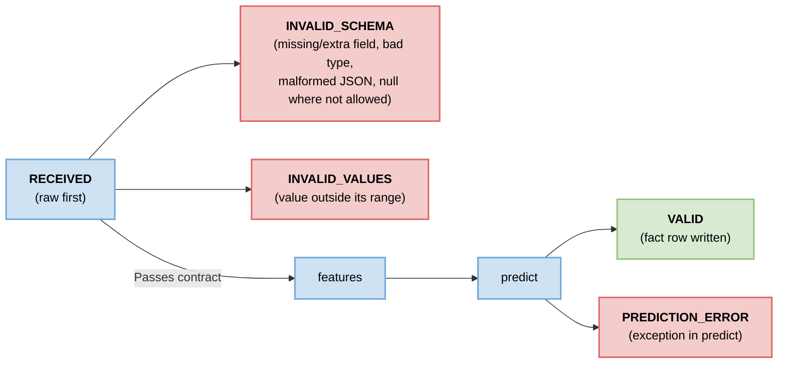
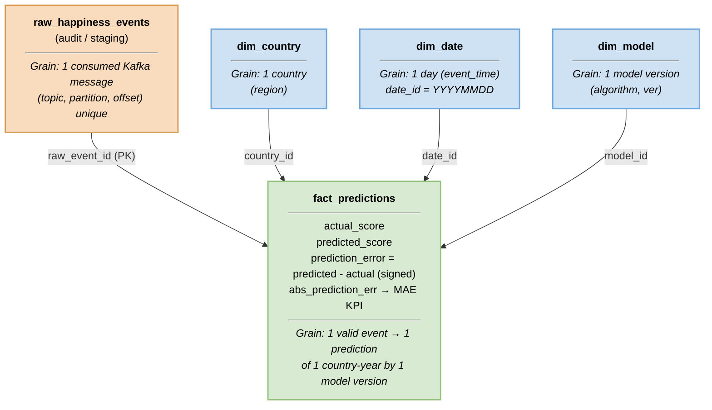
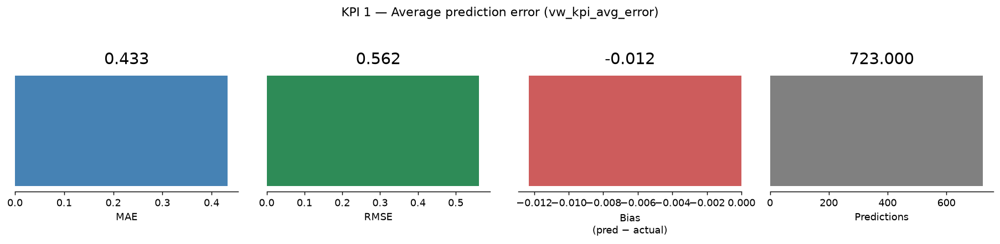
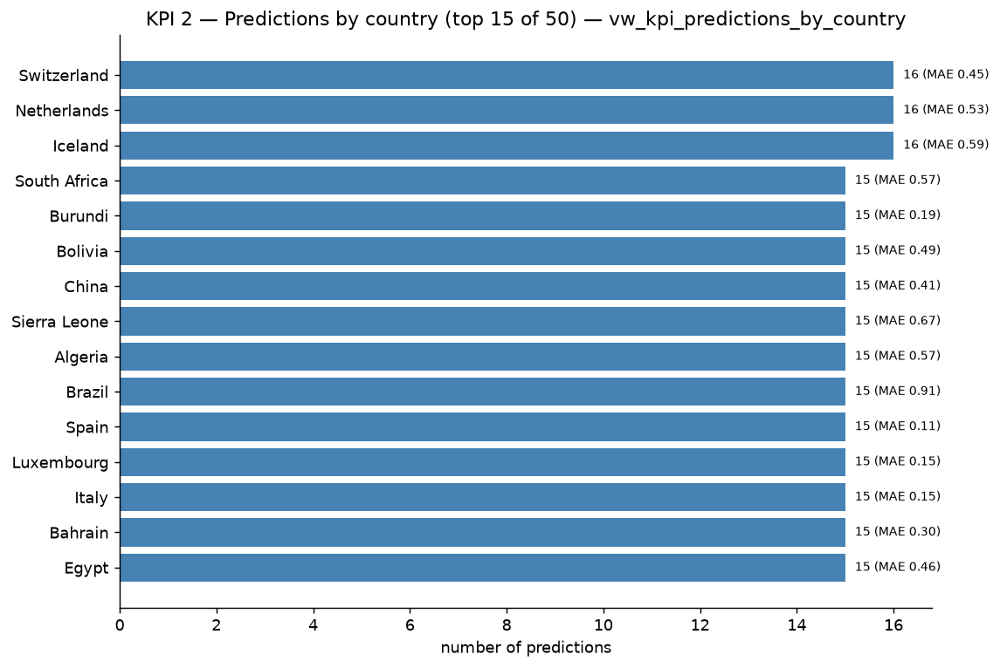
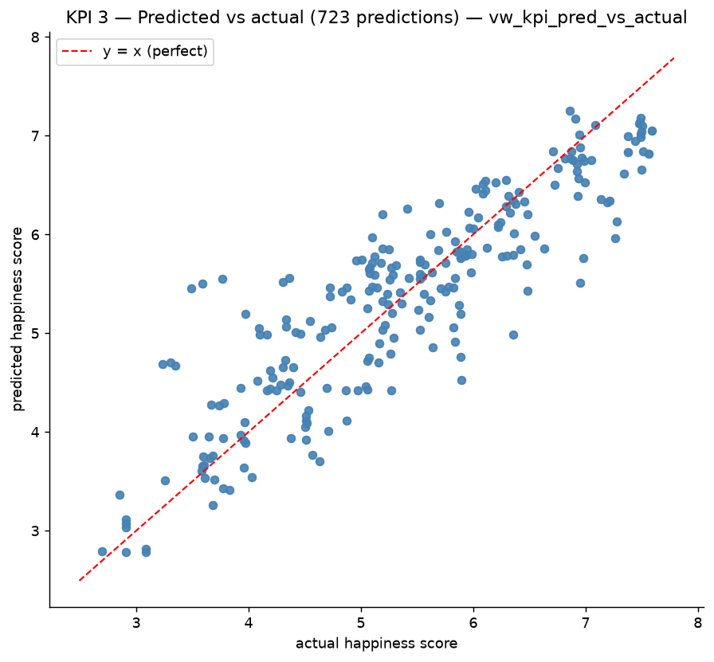
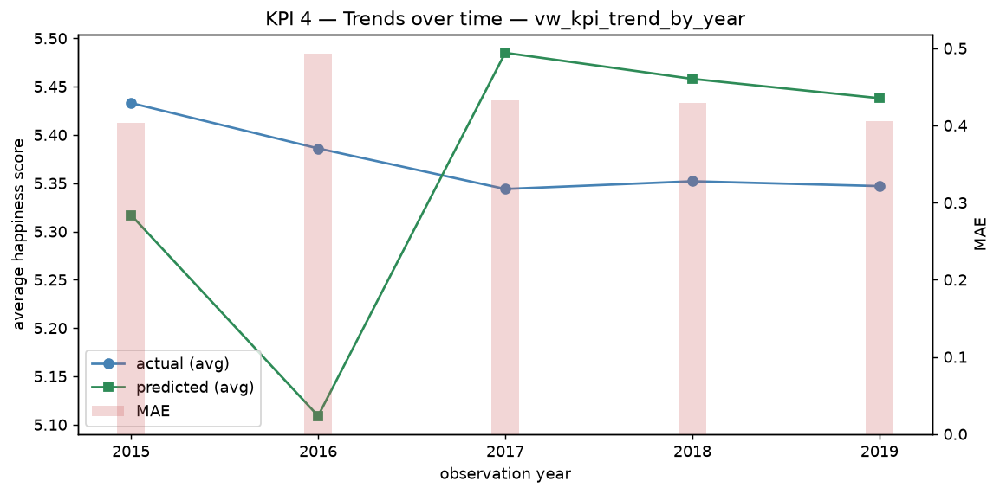
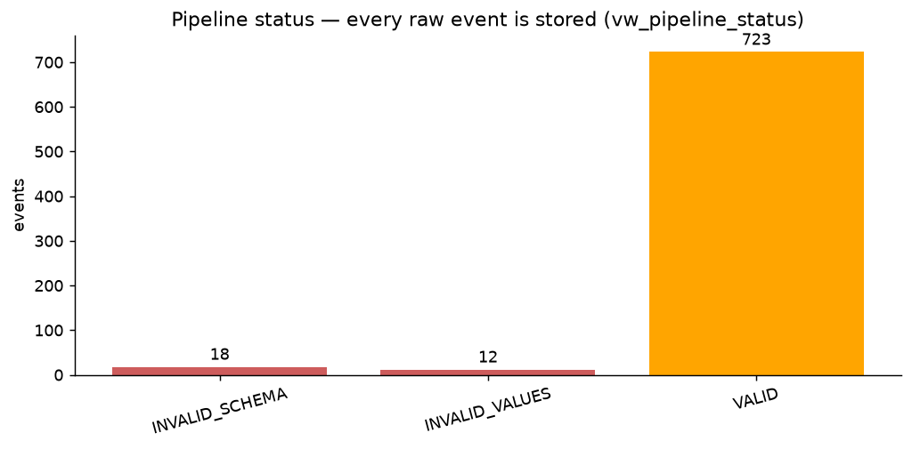

# Workshop 3 — Streaming ETL with Kafka + ML (World Happiness 2015–2019)

[](https://www.python.org/)
[](https://kafka.apache.org/)
[](https://www.postgresql.org/)
[](#9-execution-instructions)
[](docs/)

> An end-to-end, reproducible streaming ETL pipeline: five yearly CSV files are
> harmonized, validated and modeled offline (batch), then a Kafka producer
> streams country-year events through a contract-validating consumer that
> scores them with a scikit-learn model and lands everything in a dimensional
> PostgreSQL warehouse, served by KPI dashboards.

**Spanish version:** [`README_ES.md`](README_ES.md)

---

## Table of contents

1. [Project description & objective](#1-project-description--objective)
2. [Architecture](#2-architecture)
3. [Repository structure](#3-repository-structure)
4. [Data cleaning decisions](#4-data-cleaning-decisions)
5. [Feature engineering & model](#5-feature-engineering--model)
6. [Kafka pipeline & event contract](#6-kafka-pipeline--event-contract)
7. [Database schema](#7-database-schema)
8. [Dashboard & KPIs](#8-dashboard--kpis)
9. [Execution instructions](#9-execution-instructions)
10. [Limitations & future work](#10-limitations--future-work)

---

## 1. Project description & objective

The World Happiness Report publishes, every year, a score per country plus six
explanatory indicators. This project builds a **single integrated pipeline**
over the 2015–2019 editions that:

1. **Integrates & cleans** five CSVs with different schemas, column names and
   country spellings into one validated dataset (782 country-year rows).
2. **Trains a regression model** that predicts `happiness_score` from six
   indicators, evaluated honestly (no country leaks between train and test).
3. **Streams events** through Kafka: a producer emits country-year events, a
   consumer validates them against a strict contract, predicts with the trained
   model and loads a raw layer + a fact table in PostgreSQL.
4. **Shows KPIs** in dashboards that query the database views directly
   (never CSV files), plus operational health metrics via Prometheus/Grafana.

The goal is a **reliable, reproducible, integrated pipeline** — not a
state-of-the-art model. Everything runs from a Nix shell with one compose file
that works with **both Podman (`podman-compose`) and Docker (`docker compose`)**.

### Headline results

| Stage | Result |
|---|---|
| Unified dataset | 782 rows × 10 cols, **0 nulls**, `(country, year)` unique, 164 countries |
| Model (group split) | **MAE 0.4318 · RMSE 0.5619 · R² 0.7838** |
| Great Expectations | 29 expectations, **0 failed → PASSED** |
| Event contract tests | `pytest` → **56 passed** |
| Streaming demo run | raw 250 events = 240 `VALID` + 6 `INVALID_SCHEMA` + 4 `INVALID_VALUES`; `fact_predictions` = **240 = VALID count** |
| Streaming KPI | MAE 0.4319, bias −0.0098 (matches offline evaluation) |

---

## 2. Architecture



### Design decisions

| Decision | Rationale |
|---|---|
| **Airflow orchestrates the batch (Part A), never the consumer** | The consumer is a continuous service; Airflow is for tasks with a start and end. |
| **Superset = business dashboard; Grafana = pipeline health** | They answer different questions: KPIs from PostgreSQL views vs. events/sec, lag and latency from Prometheus. Not redundant. |
| **Great Expectations validates the batch dataset; a light Python function validates each event** | GE per message would be far too slow; the contract module is the single source of truth for the streaming side. |
| **`confluent-kafka` instead of `kafka-python`** | Better maintained, faster, supports manual commits and delivery reports. |
| **Raw-first loading** | Every message — valid or not — is persisted before validation, so nothing is ever lost and invalid events are auditable/reprocessable. |
| **Single `src/contract.py`** | Producer, consumer, training and tests import the same `FEATURES`, ranges and statuses; nothing can drift. |
| **One compose file, Podman & Docker** | `docker-compose.yml` uses portable syntax only; `flake.nix` ships `podman` + `podman-compose` (and deliberately not the Go `docker-compose`, which would hijack `docker compose`). |
| **Kafka data in a named volume (`kafka-data`)** | `podman-compose up` must not wipe offsets while Postgres keeps rows (offset/row mismatch breaks at-least-once replay). |

---

## 3. Repository structure

```
workshop-3/
├── flake.nix  flake.lock          # Nix env: python312 + uv + podman + kcat + psql
├── docker-compose.yml             # works with podman-compose AND docker compose
├── requirements.txt               # pinned deps (installed by uv on `nix develop`)
├── .env.example                   # copy to .env (never committed)
├── README.md  README_ES.md
├── data/
│   ├── raw/                       # 2015.csv … 2019.csv (untouched sources)
│   ├── reference/                 # country_aliases.csv (versioned alias dictionary)
│   ├── processed/                 # unified_happiness.{parquet,csv}
│   └── streaming/                 # stream_events.csv + invalid_events.csv (demo)
├── notebooks/
│   ├── eda.{py,ipynb}             # EDA + cleaning observations
│   └── model_training.{py,ipynb}  # features, splits, metrics
├── src/
│   ├── config.py                  # env-driven settings (paths, DSN, topic, group)
│   ├── harmonize.py               # schema mapping, aliases, imputation, invariants
│   ├── contract.py                # ★ single source of truth: features, ranges, statuses
│   ├── validate.py                # Great Expectations suite over the unified dataset
│   ├── train.py                   # split → pipeline → metrics → stream/invalid CSVs
│   └── metrics.py                 # Prometheus counters/histograms
├── kafka/
│   ├── producer.py                # CSV → topic, key = country, --inject-invalid
│   └── consumer.py                # raw-first, validate, predict, fact load, commit
├── airflow/
│   ├── Dockerfile  requirements-airflow.txt
│   └── dags/happiness_batch_training.py   # harmonize → validate_ge → train → export
├── sql/
│   ├── create_tables.sql          # 5 tables, idempotent (auto-run at Postgres init)
│   └── kpis.sql                   # 6 analytical views (auto-run at init)
├── monitoring/
│   ├── prometheus.yml             # scrapes consumer :8000/metrics
│   └── grafana/                   # datasource + dashboard provisioning
├── dashboards/
│   ├── kpi_charts.py              # renders KPI screenshots from the vw_* views
│   ├── screenshots/*.png          # exported dashboard images
│   └── superset/Dockerfile        # image with psycopg2 for the Postgres DB
├── models/                        # model.pkl + model_metadata.json
├── tests/                         # test_contract.py + test_harmonize.py (56 tests)
├── docs/                          # original workshop PDF
└── guia.md                        # internal work plan (Spanish)
```

---

## 4. Data cleaning decisions

The five yearly files differ in **column names, extra columns and country
spellings**. Every decision below is implemented in `src/harmonize.py` and
surfaced by `python -m src.harmonize`.

| Problem | Decision | Justification |
|---|---|---|
| Different column names per year (`Happiness Score` / `Happiness.Score` / `Score`; `Family` / `Social support`; …) | Explicit per-year `RENAME` map → one unified snake_case schema (`country, year, region, gdp, family, health, freedom, generosity, corruption, happiness_score`) | One schema for GE, training and the DAG; fails loudly if an expected column is missing. |
| Extra columns: `Happiness Rank`, `Standard Error`, `Whiskers.*`, `Confidence Interval`, `Dystopia Residual` | **Dropped** | They are derived from the score or its uncertainty → target leakage, and they don't exist in a streaming event. |
| Country name variants (`Trinidad & Tobago`/`Trinidad and Tobago`, `Hong Kong S.A.R., China`/`Hong Kong`, `Taiwan Province of China`, `Macedonia`, `Northern Cyprus`, `Somaliland Region`) | Versioned alias dictionary `data/reference/country_aliases.csv`, applied **before** the merge, plus whitespace normalization | Prevents duplicate countries in `dim_country` and a wrong "predictions by country" KPI. Verified afterwards: 18 countries appear in <5 years — all genuine source gaps, no leftover variants. |
| `region` exists only in 2015–2016 | Build `dim_country(country, region)` from those two years and propagate; fill `Unknown` otherwise | Region is metadata for the dimension table; it is **not** a feature (the event contract doesn't carry it). |
| One missing value in 782 rows: `corruption` for **United Arab Emirates, 2018** | Impute with the mean of that country's other years (0.3120); fallback = column median | Dropping the row would lose a whole country-year; one cell doesn't justify discarding five valid indicators. The model pipeline keeps `SimpleImputer(median)` as a safety net for new events. |
| Exact zeros in components (e.g. Sierra Leone, Lesotho 2017) | **Keep** them | They are published values at the bottom of the scale, not disguised nulls. |
| Non-numeric cells | `pd.to_numeric(errors="raise")` | A non-numeric cell is a bug, not a silent NaN. |
| Possible outlier: `generosity ≈ 0.838` (2017) | **Keep**, flag in the EDA | It is a real value for a real country; IQR/z-score is reported, not deleted. |
| Duplicates / type drift | Enforce `float64`/`int64`/`string` dtypes; **raise** on nulls, duplicate `(country, year)` or years outside 2015–2019 after cleaning | Invariants make both the notebook and the Airflow DAG fail loudly instead of shipping bad data. |

**Quality gate:** `python -m src.validate` runs 29 Great Expectations
(not-null, types, ranges, uniqueness of `(country, year)`, allowed years)
against the unified dataset and exits non-zero on any failure — this is the
step that stops the Airflow DAG.

---

## 5. Feature engineering & model

### Features (fixed order — the contract repeats it)

| # | Feature | Source column(s) | Notes |
|---|---|---|---|
| 1 | `gdp` | `Economy (GDP per Capita)` / `GDP per capita` | |
| 2 | `family` | `Family` / `Social support` | |
| 3 | `health` | `Health (Life Expectancy)` / `Healthy life expectancy` | |
| 4 | `freedom` | `Freedom` / `Freedom to make life choices` | |
| 5 | `generosity` | `Generosity` | weakest correlate (r ≈ 0.14) |
| 6 | `corruption` | `Trust (Government Corruption)` / `Perceptions of corruption` | |

- **Target:** `happiness_score`. In the Kafka event it travels as
  `actual_happiness_score` **for evaluation only** — it must never be a model
  input (target leakage; enforced by the contract and the tests).
- **Excluded:** `region` (not available in the event), rank/error/whiskers/
  dystopia (derived from the target).

### Split & metrics

- **Split:** `GroupShuffleSplit(test_size=0.3, random_state=42, groups=country)`
  — a country is either in train or test, never in both, so the R² measures
  generalization to *unseen countries* (a random split leaks country identity).
- **Pipeline:** `SimpleImputer(median) → StandardScaler → LinearRegression`,
  saved whole as `models/model.pkl` (the consumer loads it as-is).

| Model / split | MAE | RMSE | R² |
|---|---|---|---|
| **LinearRegression, group split (chosen)** | **0.4318** | **0.5619** | **0.7838** |
| LinearRegression, random split | 0.4487 | 0.5846 | 0.7263 |
| RandomForest, group split | 0.4771 | 0.6074 | 0.7474 |

All metrics, the feature list, the split definition and the comparison table
are stored in `models/model_metadata.json` (version
`happiness-linreg-<timestamp>`).

The training step also exports:

- `data/streaming/stream_events.csv` — the **240 test-set rows** streamed as
  valid events (evaluation set = streaming set);
- `data/streaming/invalid_events.csv` — 10 deliberately broken events
  (missing field, non-integer year, negative GDP, out-of-range score, NaN
  feature, malformed JSON, …) with their expected validation status, used by
  `producer.py --inject-invalid`.

---

## 6. Kafka pipeline & event contract

### Topic & consumer group

| Setting | Value |
|---|---|
| Topic | `happiness-events` |
| Partitions / replication | **3 / 1** (created by `kafka-init`) |
| Message key | **`country`** (same country → same partition → ordered per country) |
| Consumer group | `happiness-ml-team` |
| Auto-commit | **disabled** (`enable.auto.commit=False`) — offsets commit only after the fact row is stored |
| Delivery | at-least-once + idempotent inserts (`UNIQUE (topic, partition, offset)` + `ON CONFLICT DO NOTHING`) |

### Event contract (`src/contract.py` — single source of truth)

| Field | Type | Rule |
|---|---|---|
| `event_id` | string | required, non-empty |
| `country` | string | required, non-empty |
| `year` | integer | 2015–2019 |
| `gdp` | number | 0.0–2.5 |
| `family` | number | 0.0–2.0 |
| `health` | number | 0.0–1.5 |
| `freedom` | number | 0.0–1.0 |
| `generosity` | number | 0.0–1.0 |
| `corruption` | number | 0.0–1.0 |
| `actual_happiness_score` | number | 0.0–10.0 — **evaluation only, never a feature** |
| `event_time` | ISO-8601 string | required, parseable |

Example message (as stored in `raw_happiness_events.payload_json`):

```json
{
  "event_id": "r4E0001",
  "country": "Switzerland",
  "year": 2015,
  "gdp": 1.39651,
  "family": 1.34951,
  "health": 0.94143,
  "freedom": 0.66557,
  "generosity": 0.29678,
  "corruption": 0.41978,
  "actual_happiness_score": 7.587,
  "event_time": "2026-11-01T13:29:56"
}
```

### Validation states



- **Every** message is written to `raw_happiness_events` *before* validation,
  so the raw layer holds all 250 demo events (240 `VALID`, 6 `INVALID_SCHEMA`,
  4 `INVALID_VALUES`).
- An invalid event is stored, **skipped** (no fact row) and never crashes the
  consumer; the offset is still committed so the stream keeps flowing.
- Message processing order: **save raw → validate → features → predict →
  save fact → commit offset.**

### Producer / consumer CLI

```bash
python kafka/producer.py --delay 0.5 --run-id r5 --inject-invalid
#   --file PATH        events CSV (default data/streaming/stream_events.csv)
#   --delay SEC        pause between messages (default 0.5)
#   --limit N          send only the first N events
#   --run-id PREFIX    prefixes event_id so runs are traceable
#   --inject-invalid   append the 10 broken events from invalid_events.csv

python kafka/consumer.py
#   --group happiness-ml-team   --topic happiness-events
#   --metrics-port 8000         exposes Prometheus /metrics
```

---

## 7. Database schema

`sql/create_tables.sql` is idempotent (`CREATE TABLE IF NOT EXISTS`) and runs
automatically at first Postgres boot
(`docker-entrypoint-initdb.d/01_create_tables.sql`); `sql/kpis.sql` creates
the views the same way.



| Table | Grain | Purpose |
|---|---|---|
| `raw_happiness_events` | 1 Kafka message (`topic, partition, offset` unique) | Raw layer: original payload untouched, `processing_status`, `error_detail`, Kafka coordinates. Idempotent under redelivery. |
| `dim_country` | 1 country | Name + region (propagated from 2015–16). |
| `dim_date` | 1 calendar day | Derived from `event_time` (pipeline time). |
| `dim_model` | 1 model version | Traceability: version string + algorithm; enables KPI-by-model. |
| `fact_predictions` | 1 valid event → 1 scored country-year | Actual vs. predicted score, signed/absolute error, FKs to all dims + `raw_event_id`. |

Current demo state: **250 raw rows** (240 `VALID` + 6 `INVALID_SCHEMA` +
4 `INVALID_VALUES`) and **240 fact rows** — `fact count == VALID count`, and
each fact's `raw_event_id` joins back to a `VALID` raw row.

---

## 8. Dashboard & KPIs

Dashboards **query the PostgreSQL views** (`sql/kpis.sql`) — never CSV files.

| KPI | View | Question it answers |
|---|---|---|
| **KPI 1 — Average prediction error** | `vw_kpi_avg_error` | How wrong is the model overall? (MAE, RMSE, signed bias, n) |
| **KPI 2 — Predictions by country** | `vw_kpi_predictions_by_country` | Where are we scoring the most (and with what MAE)? Top 15 + region. |
| **KPI 3 — Predicted vs. actual** | `vw_kpi_pred_vs_actual` | Scatter vs. the y = x line: systematic bias? |
| **KPI 4 — Trend over time** | `vw_kpi_trend_by_year` | Avg actual vs. avg predicted per observation year + MAE bars. |
| Pipeline health | `vw_pipeline_status` | Event counts per `processing_status` — the contract validation in action. |
| Model comparison | `vw_kpi_by_model` | MAE per model version (enabled by `dim_model`). |

### Services: URLs and credentials

| Service | URL / Host | Login / credentials |
|---|---|---|
| **Airflow** | http://localhost:8080 | `admin` / `admin` |
| **Superset** | http://localhost:8088 | `admin` / `admin` |
| **Grafana** | http://localhost:3000 | `admin` / `admin` |
| **Prometheus** | http://localhost:9090 | no login (target `happiness-ml-consumer`) |
| **PostgreSQL (project)** | `localhost:5432` | user `happiness` · password `happiness` · db `happiness` |
| **PostgreSQL (Airflow)** | `airflow-db:5432` (host `localhost:5432`) | user `airflow` · password `airflow` · db `airflow` |
| **Kafka (from the host)** | `localhost:29092` | PLAINTEXT |
| **Kafka (container-to-container)** | `kafka:9092` | PLAINTEXT |
| **Consumer metrics** | http://localhost:8000/metrics | — |

Start them with the menu option 4, or per profile:

```bash
podman-compose --profile airflow    up -d --build   # Airflow :8080
podman-compose --profile dashboards up -d --build   # Superset :8088
podman-compose --profile monitoring up -d           # Prometheus :9090 + Grafana :3000
```

Validate Kafka:

```bash
# topic: 3 partitions, RF 1
podman exec kafka /opt/kafka/bin/kafka-topics.sh --bootstrap-server localhost:9092 --describe --topic happiness-events
# consumer group offsets vs. end of partition
podman exec kafka /opt/kafka/bin/kafka-consumer-groups.sh --bootstrap-server localhost:9092 --group happiness-ml-team --describe
# last raw events (kcat ships in the flake)
nix develop --command kcat -L -b localhost:29092 -t happiness-events -C -o -5 -e
```

Validate the data:

```bash
podman exec -it happiness-postgres psql -U happiness -d happiness
```
```sql
select processing_status, count(*) from raw_happiness_events group by 1;
select count(*) from fact_predictions;   -- must equal the VALID row count
select * from vw_pipeline_status;
```

### Expected service status

| Service | Expected state | How to check |
|---|---|---|
| Airflow :8080 | `webserver` + `scheduler` up, `init` Exited(0) | `http://localhost:8080/login/` → 200; DAGs listed |
| Superset :8088 | up, `init` Exited(0) (admin created) | `http://localhost:8088/login/` → 200 |
| Grafana :3000 | up | `http://localhost:3000/api/health` ok; datasource `Prometheus → http://prometheus:9090` |
| Prometheus :9090 | up | `http://localhost:9090/api/v1/targets` → target `happiness-ml-consumer` = `up` |
| Kafka :29092 | healthy | topic `happiness-events`, 3 partitions / RF 1 |
| PostgreSQL :5432 | healthy | 5 tables + 6 `vw_*` views |
| Consumer :8000 | running | `events_consumed_total{status=…}` in `/metrics` |

DAGs ship **paused**: unpause them from the UI (▶) or use menu options 9/10.

### Database connection (DBeaver CE)

| Field | Value |
|---|---|
| Host | `localhost` |
| Port | `5432` |
| Database | `happiness` |
| Username | `happiness` |
| Password | `happiness` |
| Driver | PostgreSQL |

Tables: `raw_happiness_events`, `fact_predictions`, `dim_country`, `dim_date`,
`dim_model` + views `vw_kpi_*`, `vw_pipeline_status`.
A second database on the same instance holds Airflow metadata:
db `airflow` · user `airflow` · password `airflow`.

### Superset dashboard (bootstrap)

Superset ships **empty**: connection, datasets, charts and dashboard are
created by an idempotent script (menu option 4 runs it automatically):

```bash
python dashboards/superset/bootstrap_dashboards.py           # create/refresh
python dashboards/superset/bootstrap_dashboards.py --verify  # query checks only
```

It creates the `happiness` connection (PostgreSQL), 6 datasets (5 physical
views +1 pre-sorted virtual one), 8 charts (2 big numbers, 4 tables, 1 bar
chart, 1 pie chart) and the dashboard **Happiness KPIs**, then runs every
chart query through the API and checks the dashboard↔chart link.

Open it at <http://localhost:8088/superset/dashboard/1/> (`admin`/`admin`).

### Grafana dashboards (provisioned)

Three dashboards are provisioned from `monitoring/grafana/dashboards/*.json`
(Grafana re-scans every 30 s, no import needed):

| Dashboard | Panels | What it shows |
|---|---|---|
| `Happiness Pipeline Health` | 5 | events/min by status, total consumed, invalid/min, latency p95, MAE (5m) |
| `Happiness ML Quality` | 8 | MAE cumulative, predictions scored, invalid ratio, uptime, error p50/p95/p99, share of errors > 0.5, latency quantiles, invalids by status |
| `Happiness Consumer Runtime` | 6 | CPU %, RSS/VMS, open FDs, GC collections, GC objects, uptime |

### Where to look

| URL | What |
|---|---|
| http://localhost:8088 | **Superset** (business KPIs, login `admin`/`admin`) — DB `happiness` on `postgres:5432` |
| http://localhost:3000 | **Grafana** (pipeline health, login `admin`/`admin`) — Prometheus datasource auto-provisioned |
| http://localhost:9090 | **Prometheus** — target `happiness-ml-consumer` scrapes `consumer:8000/metrics` every 10 s |
| `dashboards/screenshots/*.png` | Rendered KPI charts (regenerate with `python dashboards/kpi_charts.py`) |

The consumer exports `events_consumed_total{status=…}`,
`prediction_latency_seconds` and `prediction_abs_error` to Prometheus, so
Grafana shows throughput, invalid rate, latency and error distribution live.







---

## 9. Execution instructions

> You can execute and manage the entire lifecycle using the unified automation scripts:
> - **Linux / NixOS / macOS:** `./run.sh [option]`
> - **Windows (cmd/powershell):** `run.bat [option]`
>
> Both scripts auto-detect **Podman** or **Docker**, provide interactive or automatic modes, manage container lifecycles, and write execution audits to `logs/`.

### 0. Quick Start via Unified Scripts (`run.sh` / `run.bat`)

| Command (Linux / NixOS) | Command (Windows) | Action |
|---|---|---|
| `./run.sh` | `run.bat` | **Interactive Menu** with all options |
| `./run.sh auto` | `run.bat auto` | **End-to-End Automatic Run** (infra + batch + tests + streaming demo + charts) |
| `./run.sh step` | `run.bat step` | **Step-by-Step Interactive** mode (asks confirmation before each step) |
| `./run.sh start` | `run.bat start` | Start base infrastructure (Kafka + PostgreSQL) |
| `./run.sh start-all` | `run.bat start-all` | Start all services (Kafka, Postgres, Airflow, Superset, Prometheus, Grafana) |
| `./run.sh stop` | `run.bat stop` | Stop running containers |
| `./run.sh clean` | `run.bat clean` | Wipe containers and persistent volumes (`down -v`) |
| `./run.sh recreate` | `run.bat recreate` | Clean reset + restart infra + fresh harmonization and model training |
| `./run.sh test` | `run.bat test` | Run contract test suite (`pytest -q`) |
| `./run.sh airflow-success` | `run.bat airflow-success` | Run Airflow DAG **Happy Path** (`happiness_batch_training`) |
| `./run.sh airflow-fail` | `run.bat airflow-fail` | Run Airflow DAG **Controlled Failure Demo** (`happiness_batch_failure_demo`) |
| `./run.sh status` | `run.bat status` | Show container health and PostgreSQL table row counts |

### 1. Execution Logs & Auditability (`logs/` directory)

Every run from `run.sh` or `run.bat` automatically writes execution logs to the `logs/` directory:
- `logs/run_YYYYMMDD_HHMMSS.log`: Timestamped audit log of all executed commands, outputs, and exit codes.
- `logs/latest.log`: Symlink pointing to the most recent run for quick inspection (`tail -f logs/latest.log`).

---

### 2. Airflow DAGs (Success & Controlled Failure Scenarios)

The repository provides **two distinct Airflow DAGs** to demonstrate pipeline resilience and dependency management:

1. **`happiness_batch_training` (Happy Path / Success):**
   - File: [`airflow/dags/happiness_batch_training.py`](airflow/dags/happiness_batch_training.py)
   - Flow: `harmonize` → `validate_ge` (29 Great Expectations pass) → `train` (LinearRegression) → `export_stream`.
   - Result: All tasks pass with status `SUCCESS`. Output artifacts are written safely.
   - Run via CLI:
     ```bash
     ./run.sh airflow-success
     # or manual:
     podman-compose --profile airflow exec airflow-scheduler airflow dags test happiness_batch_training
     ```

2. **`happiness_batch_failure_demo` (Controlled Quality Failure):**
   - File: [`airflow/dags/happiness_batch_training_failure_demo.py`](airflow/dags/happiness_batch_training_failure_demo.py)
   - Flow: `harmonize` → `validate_ge` (deliberate out-of-scale anomaly injected: `happiness_score = 99.0`).
   - Behavior: Great Expectations detects the anomaly and raises `RuntimeError`. Airflow flags `validate_ge` as `FAILED` and automatically halts the pipeline.
   - Protection: Downstream tasks `train` and `export_stream` are marked as `UPSTREAM_FAILED` and **never execute**, preventing model corruption from invalid data.
   - Run via CLI:
     ```bash
     ./run.sh airflow-fail
     # or manual:
     podman-compose --profile airflow exec airflow-scheduler airflow dags test happiness_batch_failure_demo
     ```

---

### 3. Manual Step-by-Step Execution (CLI / Nix Shell)

If you prefer to run commands manually step-by-step:

#### 3.1 Prerequisites
- [Nix](https://nixos.org/download/) (with flakes enabled)
- Podman **or** Docker
- Git

#### 3.2 Enter Environment & Start Infrastructure
```bash
nix develop            # Python 3.12 + uv + podman + podman-compose + kcat + psql
cp .env.example .env   # adjust only if your ports/DSN differ

# Start Kafka and PostgreSQL:
podman-compose up -d kafka kafka-init postgres
# Verify topic creation:
kcat -L -b localhost:29092
```

Optional services (profiles):
```bash
podman-compose --profile monitoring up -d           # Prometheus + Grafana
podman-compose --profile dashboards up -d --build   # Superset (:8088)
podman-compose --profile airflow up -d --build      # Airflow (:8080, admin/admin)
```

#### 3.3 Batch Pipeline (Part A)
```bash
python -m src.harmonize   # → data/processed/unified.* (782 rows, 0 nulls)
python -m src.validate    # → 29 Great Expectations, exits ≠ 0 on failure
python -m src.train       # → models/model.pkl + model_metadata.json + data/streaming/*.csv
pytest -q                 # → 56 passed (event contract + harmonization)
```

#### 3.4 Stream (Part B) — Two Terminals in Nix Shell

```bash
# terminal A — consumer (raw → validate → predict → fact → commit)
python kafka/consumer.py

# terminal B — producer (valid events + 10 deliberately invalid ones)
python kafka/producer.py --delay 0.5 --run-id demo --inject-invalid
```

Expected consumer output: events flowing with statuses; invalid events are
stored and skipped without killing the process.

### 5. Verify the demo invariants

```bash
python dashboards/kpi_charts.py    # regenerate dashboards/screenshots/*.png
```

```sql
-- raw vs facts (psql "$DATABASE_URL")
SELECT processing_status, COUNT(*) FROM raw_happiness_events GROUP BY 1;
--  INVALID_SCHEMA 6 | INVALID_VALUES 4 | VALID 240
SELECT COUNT(*) FROM fact_predictions;      -- 240  (== VALID)
```

Then open **Superset** (http://localhost:8088) for business KPIs and
**Grafana** (http://localhost:3000) for pipeline health. Charts change as new
events arrive because they query the views, not files.

### 6. Stop / reset

```bash
podman-compose --profile monitoring --profile dashboards --profile airflow down
# Kafka offsets persist in the kafka-data volume. If you recreate the Kafka
# container while keeping Postgres, reset both sides together:
#   TRUNCATE raw_happiness_events, fact_predictions RESTART IDENTITY;
```

### Troubleshooting

| Symptom | Fix |
|---|---|
| Consumer: `Connection refused` to Kafka/Postgres | `podman-compose up -d kafka postgres`, wait until `healthy`. |
| Consumer: `localhost:8000 already in use` | Another consumer instance is running; kill it (`pkill -f "[k]afka/consumer.py"`). |
| Duplicate/missing offsets after `podman-compose up` | Recreating Kafka without `kafka-data` wipes offsets while Postgres keeps rows → reset the DB tables (see step 6). |
| `docker compose` doesn't see containers | Stay inside `nix develop`: the flake provides `podman-compose`, and `docker` is the podman shim on NixOS. |
| GE step fails in the DAG | Run `python -m src.validate` locally first; the expectation report shows the failing column. |
| Superset can't reach Postgres | Use DB host `postgres` (not `localhost`) inside the network; `SUPERSET_SECRET_KEY` set in `.env`. |

---

## 10. Limitations & future work

**Limitations**

- **Model:** linear regression on 782 rows; R² ≈ 0.78 on unseen countries.
  Accuracy is intentionally *not* optimized — the workshop grades the pipeline.
- **Scale:** one producer replaying a static CSV; no exactly-once semantics
  (at-least-once + idempotent loads instead).
- **Region coverage:** `region` only exists for 2015–2016; 18 countries appear
  in fewer than 5 years (genuine gaps in the source, not cleaning errors).
- **Indicator definitions drift slightly** between 2017 and 2018–2019
  (different underlying calculations) — acceptable for a demo, noted in the EDA.
- **Single-broker Kafka (RF 1)** — no fault tolerance, by workshop design.

**Future work**

- Add a dead-letter topic for invalid events + a reprocessing command.
- Exactly-once consumption with Kafka transactions.
- Model registry in `dim_model` with A/B comparison KPIs (view already exists).
- Great Expectations *Data Docs* published as an artifact of the DAG.
- Alerting: Grafana rules on invalid-event rate and consumer lag.

---

### Academic note

Course project — ETL G01, Workshop 3. Stack: Python 3.12 · Nix · pandas ·
scikit-learn · Great Expectations · confluent-kafka · PostgreSQL 16 · Airflow ·
Podman/Docker · Prometheus · Grafana · Superset.
