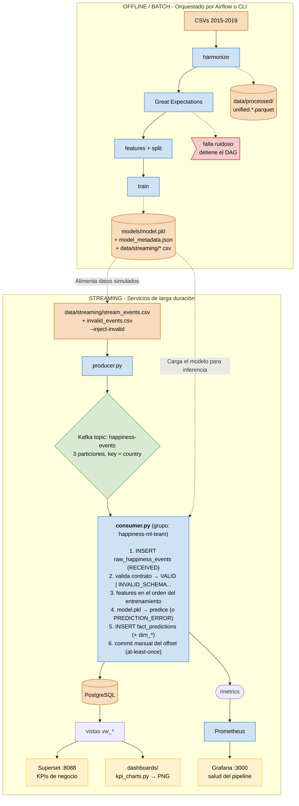
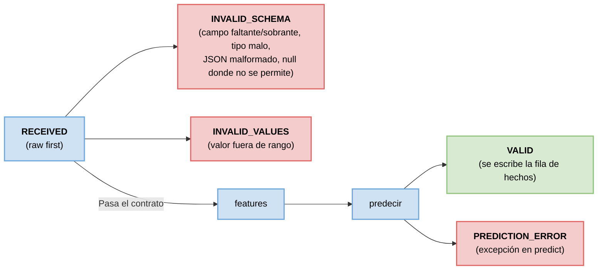
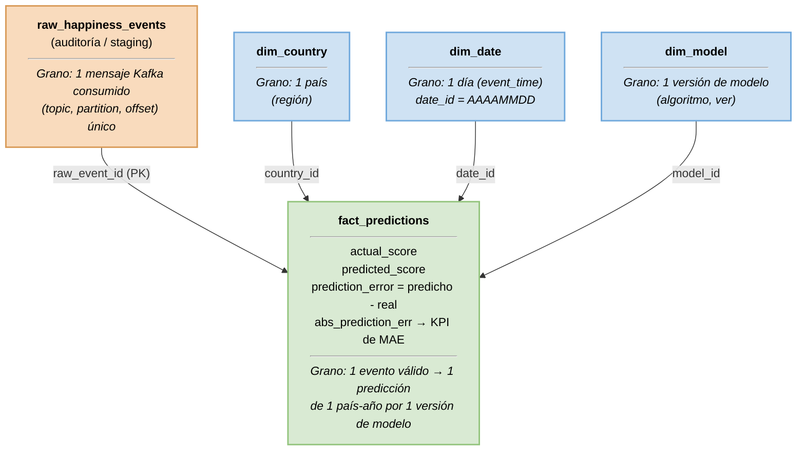
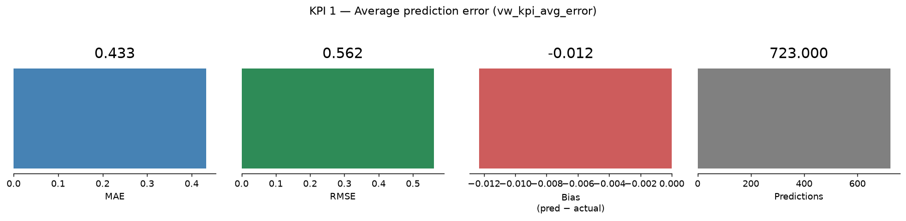
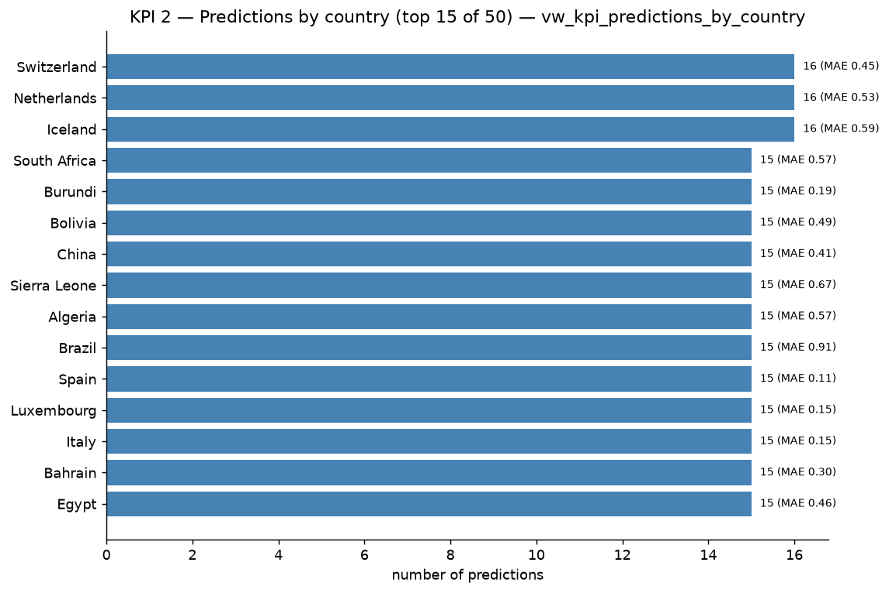
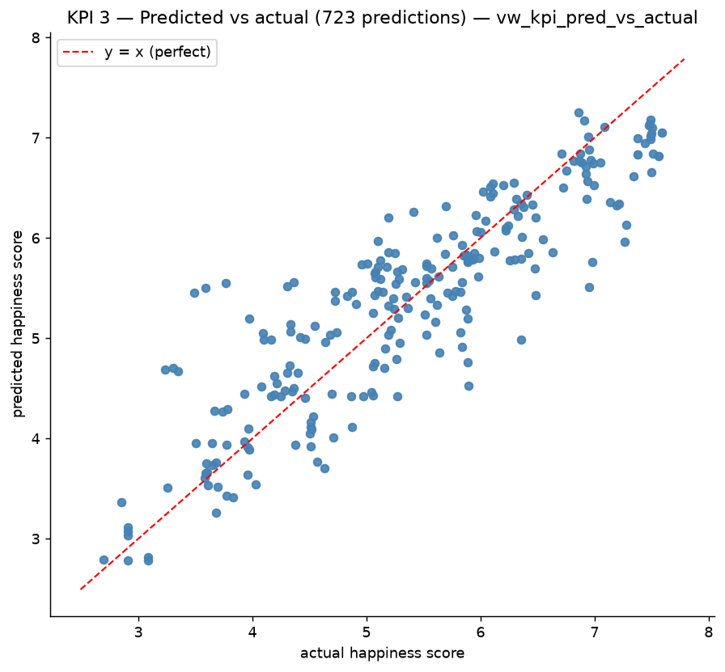
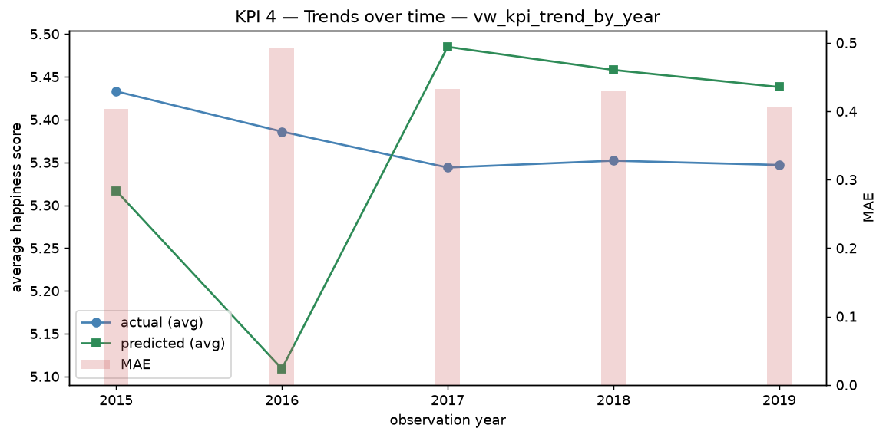
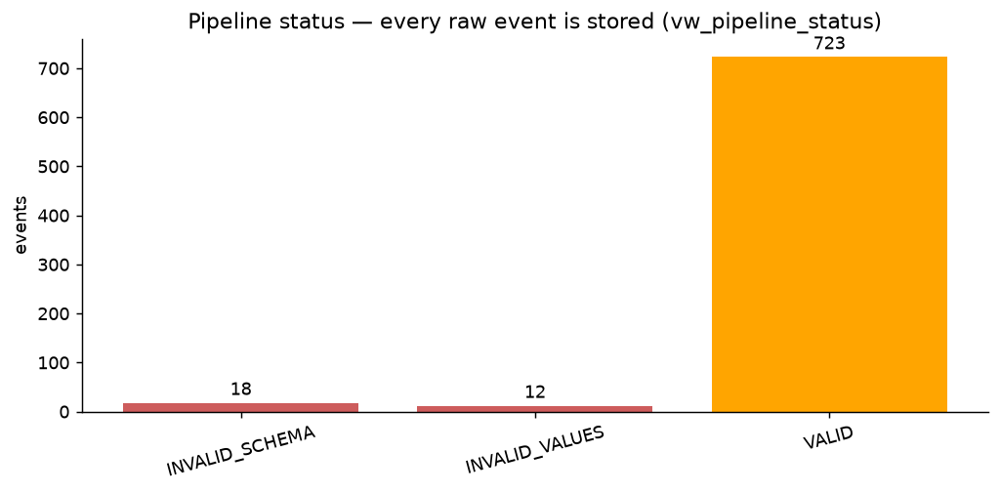

# Taller 3 — ETL en streaming con Kafka + ML (World Happiness 2015–2019)

[](https://www.python.org/)
[](https://kafka.apache.org/)
[](https://www.postgresql.org/)
[](#9-instrucciones-de-ejecución)
[](docs/)

> Pipeline ETL en streaming completo y reproducible: cinco archivos CSV anuales
> se armonizan, validan y modelan offline (batch), luego un productor Kafka
> emite eventos país-año que un consumidor valida contra un contrato, puntúa
> con un modelo scikit-learn y carga en un almacén dimensional PostgreSQL,
> servido por dashboards de KPIs.

**Versión en inglés:** [`README.md`](README.md)

---

## Índice

1. [Descripción del proyecto y objetivo](#1-descripción-del-proyecto-y-objetivo)
2. [Arquitectura](#2-arquitectura)
3. [Estructura del repositorio](#3-estructura-del-repositorio)
4. [Decisiones de limpieza](#4-decisiones-de-limpieza)
5. [Feature engineering y modelo](#5-feature-engineering-y-modelo)
6. [Pipeline Kafka y contrato del evento](#6-pipeline-kafka-y-contrato-del-evento)
7. [Esquema de base de datos](#7-esquema-de-base-de-datos)
8. [Dashboard y KPIs](#8-dashboard-y-kpis)
9. [Instrucciones de ejecución](#9-instrucciones-de-ejecución)
10. [Limitaciones y trabajo futuro](#10-limitaciones-y-trabajo-futuro)

---

## 1. Descripción del proyecto y objetivo

The World Happiness Report publica cada año un puntaje por país más seis
indicadores explicativos. Este proyecto construye **un único pipeline
integrado** sobre las ediciones 2015–2019 que:

1. **Integra y limpia** cinco CSV con esquemas, nombres de columna y grafías de
   países distintas en un solo dataset validado (782 filas país-año).
2. **Entrena un modelo de regresión** que predice `happiness_score` a partir de
   seis indicadores, evaluado sin fugas (ningún país se mezcla entre train y
   test).
3. **Transmite eventos por Kafka:** un productor emite eventos país-año, un
   consumidor los valida contra un contrato estricto, predice con el modelo
   entrenado y carga una capa raw + una tabla de hechos en PostgreSQL.
4. **Muestra KPIs** en dashboards que consultan directamente las vistas de la
   base de datos (nunca archivos CSV), más métricas operacionales vía
   Prometheus/Grafana.

La meta es un pipeline **fiable, reproducible e integrado**, no un modelo
estado del arte. Todo arranca desde un shell de Nix con **un solo archivo
compose que funciona con Podman (`podman-compose`) y Docker (`docker compose`)**.

### Resultados principales

| Etapa | Resultado |
|---|---|
| Dataset unificado | 782 filas × 10 cols, **0 nulos**, `(country, year)` único, 164 países |
| Modelo (split por país) | **MAE 0.4318 · RMSE 0.5619 · R² 0.7838** |
| Great Expectations | 29 expectativas, **0 fallidas → PASSED** |
| Tests del contrato | `pytest` → **56 passed** |
| Demo en streaming | raw 250 eventos = 240 `VALID` + 6 `INVALID_SCHEMA` + 4 `INVALID_VALUES`; `fact_predictions` = **240 = conteo de VALID** |
| KPI en streaming | MAE 0.4319, sesgo −0.0098 (coincide con la evaluación offline) |

---

## 2. Arquitectura



### Decisiones de diseño

| Decisión | Justificación |
|---|---|
| **Airflow orquesta el batch (Parte A), nunca el consumer** | El consumer es un proceso continuo; Airflow es para tareas con inicio y fin. |
| **Superset = dashboard de negocio; Grafana = salud del pipeline** | Responden preguntas distintas: KPIs desde vistas de PostgreSQL vs. eventos/seg, lag y latencia desde Prometheus. No son redundantes. |
| **Great Expectations valida el dataset batch; una función Python ligera valida cada evento** | GE por mensaje sería demasiado lento; el módulo de contrato es la única fuente de verdad del lado streaming. |
| **`confluent-kafka` en vez de `kafka-python`** | Mejor mantenida, más rápida, con commits manuales y delivery reports. |
| **Carga raw-first** | Cada mensaje — válido o no — se persiste antes de validar: nada se pierde y los inválidos quedan auditables/reprocesables. |
| **Un solo `src/contract.py`** | Producer, consumer, entrenamiento e imports comparten los mismos `FEATURES`, rangos y estados; nada puede divergir. |
| **Un solo compose, Podman y Docker** | `docker-compose.yml` usa sintaxis portable; `flake.nix` incluye `podman` + `podman-compose` (y deliberadamente no el `docker-compose` Go, que secuestraría `docker compose`). |
| **Offsets de Kafka en un volumen nombrado (`kafka-data`)** | `podman-compose up` no debe borrar offsets mientras Postgres conserva filas (el desfase rompe la reintentabilidad at-least-once). |

---

## 3. Estructura del repositorio

```
workshop-3/
├── flake.nix  flake.lock          # entorno Nix: python312 + uv + podman + kcat + psql
├── docker-compose.yml             # funciona con podman-compose Y docker compose
├── requirements.txt               # dependencias fijadas (las instala uv en `nix develop`)
├── .env.example                   # copiar a .env (nunca se commitea)
├── README.md  README_ES.md
├── data/
│   ├── raw/                       # 2015.csv … 2019.csv (fuentes intactas)
│   ├── reference/                 # country_aliases.csv (diccionario de alias versionado)
│   ├── processed/                 # unified_happiness.{parquet,csv}
│   └── streaming/                 # stream_events.csv + invalid_events.csv (demo)
├── notebooks/
│   ├── eda.{py,ipynb}             # EDA + observaciones de calidad
│   └── model_training.{py,ipynb}  # features, splits, métricas
├── src/
│   ├── config.py                  # ajustes por variables de entorno (rutas, DSN, topic)
│   ├── harmonize.py               # mapeo de esquema, alias, imputación, invariantes
│   ├── contract.py                # ★ única fuente de verdad: features, rangos, estados
│   ├── validate.py                # suite Great Expectations sobre el dataset unificado
│   ├── train.py                   # split → pipeline → métricas → CSVs de streaming
│   └── metrics.py                 # contadores/histogramas Prometheus
├── kafka/
│   ├── producer.py                # CSV → topic, key = country, --inject-invalid
│   └── consumer.py                # raw-first, valida, predice, carga fact, commit
├── airflow/
│   ├── Dockerfile  requirements-airflow.txt
│   └── dags/happiness_batch_training.py   # harmonize → validate_ge → train → export
├── sql/
│   ├── create_tables.sql          # 5 tablas, idempotente (auto en el init de Postgres)
│   └── kpis.sql                   # 6 vistas analíticas (auto en el init)
├── monitoring/
│   ├── prometheus.yml             # scrapea el /metrics :8000 del consumer
│   └── grafana/                   # datasource + provisionado de dashboards
├── dashboards/
│   ├── kpi_charts.py              # genera los screenshots desde las vistas vw_*
│   ├── screenshots/*.png          # imágenes exportadas del dashboard
│   └── superset/Dockerfile        # imagen con psycopg2 para la BD happiness
├── models/                        # model.pkl + model_metadata.json
├── tests/                         # test_contract.py + test_harmonize.py (56 tests)
├── docs/                          # PDF original del taller
└── guia.md                        # plan de trabajo interno
```

---

## 4. Decisiones de limpieza

Los cinco archivos anuales difieren en **nombres de columna, columnas
extra y grafías de países**. Cada decisión vive en `src/harmonize.py` y se
evidencia con `python -m src.harmonize`.

| Problema | Decisión | Justificación |
|---|---|---|
| Nombres distintos por año (`Happiness Score` / `Happiness.Score` / `Score`; `Family` / `Social support`; …) | Mapa explícito `RENAME` por año → un esquema unificado snake_case (`country, year, region, gdp, family, health, freedom, generosity, corruption, happiness_score`) | Un solo esquema para GE, el entrenamiento y el DAG; falla ruidoso si falta una columna esperada. |
| Columnas extra: `Happiness Rank`, `Standard Error`, `Whiskers.*`, `Confidence Interval`, `Dystopia Residual` | **Se descartan** | Son derivadas del score o de su incertidumbre → fuga de información, y no existen en un evento streaming. |
| Variantes de países (`Trinidad & Tobago`/`Trinidad and Tobago`, `Hong Kong S.A.R., China`/`Hong Kong`, `Taiwan Province of China`, `Macedonia`, `Northern Cyprus`, `Somaliland Region`) | Diccionario de alias versionado `data/reference/country_aliases.csv`, aplicado **antes** del merge + normalización de espacios | Evita países duplicados en `dim_country` y un KPI "predicciones por país" erróneo. Verificado después: 18 países aparecen en <5 años — todos huecos reales de la fuente, sin variantes residuales. |
| `region` solo existe en 2015–2016 | Construir `dim_country(country, region)` con esos dos años y propagar; rellenar `Unknown` en caso contrario | La región es metadata de la dimensión; **no** es feature (el contrato del evento no la lleva). |
| Un valor faltante en 782 filas: `corruption` de **Emiratos Árabes Unidos, 2018** | Imputar con la media de los demás años del país (0.3120); respaldo = media de la columna | Descartar la fila perdería un país-año entero; una celda no justifica desechar cinco indicadores válidos. El pipeline del modelo mantiene `SimpleImputer(median)` como red de seguridad para eventos nuevos. |
| Ceros exactos en componentes (p. ej. Sierra Leona, Lesotho 2017) | **Se conservan** | Son valores publicados en el fondo de la escala, no nulos disfrazados. |
| Celdas no numéricas | `pd.to_numeric(errors="raise")` | Una celda no numérica es un bug, no un NaN silencioso. |
| Posible outlier: `generosity ≈ 0.838` (2017) | **Se conserva**, se marca en el EDA | Es un valor real de un país real; el IQR/z-score se reporta, no se borra. |
| Duplicados / deriva de tipos | Forzar dtypes `float64`/`int64`/`string`; **lanzar error** por nulos, `(country, year)` duplicado o años fuera de 2015–2019 tras la limpieza | Los invariantes hacen que el notebook y el DAG fallen ruidoso en vez de publicar datos malos. |

**Puerta de calidad:** `python -m src.validate` ejecuta 29 expectativas de
Great Expectations (no nulos, tipos, rangos, unicidad de `(country, year)`,
años permitidos) sobre el dataset unificado y sale con código ≠ 0 ante
cualquier fallo — este es el paso que detiene el DAG de Airflow.

---

## 5. Feature engineering y modelo

### Features (orden fijo — el contrato lo repite)

| # | Feature | Columna(s) de origen | Notas |
|---|---|---|---|
| 1 | `gdp` | `Economy (GDP per Capita)` / `GDP per capita` | |
| 2 | `family` | `Family` / `Social support` | |
| 3 | `health` | `Health (Life Expectancy)` / `Healthy life expectancy` | |
| 4 | `freedom` | `Freedom` / `Freedom to make life choices` | |
| 5 | `generosity` | `Generosity` | correlación más débil (r ≈ 0.14) |
| 6 | `corruption` | `Trust (Government Corruption)` / `Perceptions of corruption` | |

- **Target:** `happiness_score`. En el evento Kafka viaja como
  `actual_happiness_score` **solo para evaluar** — nunca puede ser entrada del
  modelo (fuga de información; lo exigen el contrato y los tests).
- **Excluidos:** `region` (no disponible en el evento), rank/error/whiskers/
  dystopia (derivados del target).

### Split y métricas

- **Split:** `GroupShuffleSplit(test_size=0.3, random_state=42, groups=country)`
  — un país está en train o en test, nunca en ambos, así el R² mide
  generalización a **países no vistos** (un split aleatorio filtra la
  identidad del país).
- **Pipeline:** `SimpleImputer(median) → StandardScaler → LinearRegression`,
  guardado entero como `models/model.pkl` (el consumer lo carga tal cual).

| Modelo / split | MAE | RMSE | R² |
|---|---|---|---|
| **LinearRegression, split por país (elegido)** | **0.4318** | **0.5619** | **0.7838** |
| LinearRegression, split aleatorio | 0.4487 | 0.5846 | 0.7263 |
| RandomForest, split por país | 0.4771 | 0.6074 | 0.7474 |

Todas las métricas, la lista de features, la definición del split y la tabla
comparativa quedan en `models/model_metadata.json` (versión
`happiness-linreg-<timestamp>`).

El paso de entrenamiento también exporta:

- `data/streaming/stream_events.csv` — las **240 filas del conjunto de test**
  transmitidas como eventos válidos (el conjunto de evaluación = el de streaming);
- `data/streaming/invalid_events.csv` — 10 eventos deliberadamente rotos
  (campo faltante, año no entero, GDP negativo, score fuera de rango, feature
  NaN, JSON malformado, …) con su estado de validación esperado, usados por
  `producer.py --inject-invalid`.

---

## 6. Pipeline Kafka y contrato del evento

### Topic y grupo de consumidores

| Ajuste | Valor |
|---|---|
| Topic | `happiness-events` |
| Particiones / replicación | **3 / 1** (las crea `kafka-init`) |
| Clave del mensaje | **`country`** (mismo país → misma partición → orden por país) |
| Grupo de consumidores | `happiness-ml-team` |
| Auto-commit | **desactivado** (`enable.auto.commit=False`) — el offset se confirma solo después de guardar la fila de hechos |
| Entrega | at-least-once + inserts idempotentes (`UNIQUE (topic, partition, offset)` + `ON CONFLICT DO NOTHING`) |

### Contrato del evento (`src/contract.py` — única fuente de verdad)

| Campo | Tipo | Regla |
|---|---|---|
| `event_id` | string | obligatorio, no vacío |
| `country` | string | obligatorio, no vacío |
| `year` | entero | 2015–2019 |
| `gdp` | número | 0.0–2.5 |
| `family` | número | 0.0–2.0 |
| `health` | número | 0.0–1.5 |
| `freedom` | número | 0.0–1.0 |
| `generosity` | número | 0.0–1.0 |
| `corruption` | número | 0.0–1.0 |
| `actual_happiness_score` | número | 0.0–10.0 — **solo evaluación, nunca feature** |
| `event_time` | string ISO-8601 | obligatorio, analizable |

Ejemplo de mensaje (tal como queda en `raw_happiness_events.payload_json`):

```json
{
  "event_id": "r4E0001",
  "country": "Switzerland",
  "year": 2015,
  "gdp": 1.39651,
  "family": 1.34951,
  "health": 0.94143,
  "freedom": 0.66557,
  "generosity": 0.29678,
  "corruption": 0.41978,
  "actual_happiness_score": 7.587,
  "event_time": "2026-11-01T13:29:56"
}
```

### Estados de validación


- **Todos** los mensajes se escriben en `raw_happiness_events` *antes* de
  validar, así la capa raw conserva los 250 eventos de la demo (240 `VALID`,
  6 `INVALID_SCHEMA`, 4 `INVALID_VALUES`).
- Un evento inválido se guarda, se **salta** (sin fila de hechos) y nunca
  tumba el consumer; el offset igual se confirma para que el flujo siga.
- Orden de procesamiento por mensaje: **guardar raw → validar → features →
  predecir → guardar hechos → commit del offset.**

### CLI del producer y del consumer

```bash
python kafka/producer.py --delay 0.5 --run-id r5 --inject-invalid
#   --file PATH        CSV de eventos (por defecto data/streaming/stream_events.csv)
#   --delay SEG        pausa entre mensajes (por defecto 0.5)
#   --limit N          envía solo los primeros N eventos
#   --run-id PREFIJO   antepone un prefijo a event_id para trazar cada corrida
#   --inject-invalid   añade los 10 eventos rotos de invalid_events.csv

python kafka/consumer.py
#   --group happiness-ml-team   --topic happiness-events
#   --metrics-port 8000         expone /metrics para Prometheus
```

---

## 7. Esquema de base de datos

`sql/create_tables.sql` es idempotente (`CREATE TABLE IF NOT EXISTS`) y corre
automáticamente en el primer arranque de Postgres
(`docker-entrypoint-initdb.d/01_create_tables.sql`); `sql/kpis.sql` crea las
vistas de la misma forma.



| Tabla | Grano | Propósito |
|---|---|---|
| `raw_happiness_events` | 1 mensaje Kafka (`topic, partition, offset` único) | Capa raw: payload original intacto, `processing_status`, `error_detail`, coordenadas Kafka. Idempotente ante reentregas. |
| `dim_country` | 1 país | Nombre + región (propagada desde 2015–16). |
| `dim_date` | 1 día calendario | Derivado de `event_time` (tiempo del pipeline). |
| `dim_model` | 1 versión de modelo | Trazabilidad: versión + algoritmo; habilita el KPI por modelo. |
| `fact_predictions` | 1 evento válido → 1 país-año puntuado | Score real vs. predicho, error con/sin valor absoluto, FK a todas las dimensiones + `raw_event_id`. |

Estado actual de la demo: **250 filas raw** (240 `VALID` + 6 `INVALID_SCHEMA` +
4 `INVALID_VALUES`) y **240 filas de hechos** — `conteo de facts == conteo de
VALID`, y cada fact se une por `raw_event_id` a una fila raw `VALID`.

---

## 8. Dashboard y KPIs

Los dashboards **consultan las vistas de PostgreSQL** (`sql/kpis.sql`) — nunca
archivos CSV.

| KPI | Vista | Qué responde |
|---|---|---|
| **KPI 1 — Error promedio de predicción** | `vw_kpi_avg_error` | ¿Qué tan se equivoca el modelo en general? (MAE, RMSE, sesgo con signo, n) |
| **KPI 2 — Predicciones por país** | `vw_kpi_predictions_by_country` | ¿Dónde puntuamos más (y con qué MAE)? Top 15 + región. |
| **KPI 3 — Predicho vs. real** | `vw_kpi_pred_vs_actual` | Dispersión vs. la recta y = x: ¿sesgo sistemático? |
| **KPI 4 — Tendencia en el tiempo** | `vw_kpi_trend_by_year` | Real vs. predicho promedio por año + barras de MAE. |
| Salud del pipeline | `vw_pipeline_status` | Conteo de eventos por `processing_status` — la validación del contrato en acción. |
| Comparación de modelos | `vw_kpi_by_model` | MAE por versión de modelo (gracias a `dim_model`). |

### Servicios: URLs y credenciales

| Servicio | URL / Host | Login / credenciales |
|---|---|---|
| **Airflow** | http://localhost:8080 | `admin` / `admin` |
| **Superset** | http://localhost:8088 | `admin` / `admin` |
| **Grafana** | http://localhost:3000 | `admin` / `admin` |
| **Prometheus** | http://localhost:9090 | sin login (target `happiness-ml-consumer`) |
| **PostgreSQL (proyecto)** | `localhost:5432` | user `happiness` · password `happiness` · db `happiness` |
| **PostgreSQL (Airflow)** | `airflow-db:5432` (host `localhost:5432`) | user `airflow` · password `airflow` · db `airflow` |
| **Kafka (desde el host)** | `localhost:29092` | PLAINTEXT |
| **Kafka (entre contenedores)** | `kafka:9092` | PLAINTEXT |
| **Métricas del consumer** | http://localhost:8000/metrics | — |

Se arrancan con la opción 4 del menú, o por profile:

```bash
podman-compose --profile airflow    up -d --build   # Airflow :8080
podman-compose --profile dashboards up -d --build   # Superset :8088
podman-compose --profile monitoring up -d           # Prometheus :9090 + Grafana :3000
```

Validar Kafka:

```bash
# tópico: 3 particiones, RF 1
podman exec kafka /opt/kafka/bin/kafka-topics.sh --bootstrap-server localhost:9092 --describe --topic happiness-events
# offsets del consumer group vs. fin de partición
podman exec kafka /opt/kafka/bin/kafka-consumer-groups.sh --bootstrap-server localhost:9092 --group happiness-ml-team --describe
# últimos eventos crudos (kcat viene en el flake)
nix develop --command kcat -L -b localhost:29092 -t happiness-events -C -o -5 -e
```

Validar los datos:

```bash
podman exec -it happiness-postgres psql -U happiness -d happiness
```
```sql
select processing_status, count(*) from raw_happiness_events group by 1;
select count(*) from fact_predictions;   -- debe ser igual al conteo de VALID
select * from vw_pipeline_status;
```

### Estado esperado de los servicios

| Servicio | Estado esperado | Cómo comprobarlo |
|---|---|---|
| Airflow :8080 | `webserver` + `scheduler` up, `init` Exited(0) | `http://localhost:8080/login/` → 200; DAGs listados |
| Superset :8088 | up, `init` Exited(0) (admin creado) | `http://localhost:8088/login/` → 200 |
| Grafana :3000 | up | `http://localhost:3000/api/health` ok; datasource `Prometheus → http://prometheus:9090` |
| Prometheus :9090 | up | `http://localhost:9090/api/v1/targets` → target `happiness-ml-consumer` = `up` |
| Kafka :29092 | healthy | topic `happiness-events`, 3 particiones / RF 1 |
| PostgreSQL :5432 | healthy | 5 tablas + 6 vistas `vw_*` |
| Consumer :8000 | corriendo | `events_consumed_total{status=…}` en `/metrics` |

Los DAGs nacen **pausados**: despausalos desde la UI (▶) o usa las opciones 9/10 del menú.

### Conexión a la base de datos (DBeaver CE)

| Campo | Valor |
|---|---|
| Host | `localhost` |
| Port | `5432` |
| Database | `happiness` |
| Username | `happiness` |
| Password | `happiness` |
| Driver | PostgreSQL |

Tablas: `raw_happiness_events`, `fact_predictions`, `dim_country`, `dim_date`,
`dim_model` + vistas `vw_kpi_*`, `vw_pipeline_status`.
En la misma instancia hay una segunda BD con los metadatos de Airflow:
db `airflow` · user `airflow` · password `airflow`.

### Dashboard de Superset (bootstrap)

Superset nace **vacío**: la conexión, los datasets, los charts y el dashboard
los crea un script idempotente (la opción 4 del menú lo ejecuta solo):

```bash
python dashboards/superset/bootstrap_dashboards.py           # crear/actualizar
python dashboards/superset/bootstrap_dashboards.py --verify  # solo comprobaciones
```

Crea la conexión `happiness` (PostgreSQL), 6 datasets (5 vistas físicas + 1
virtual pre-ordenada), 8 charts (2 big numbers, 4 tablas, 1 gráfico de barras,
1 gráfico de pastel) y el dashboard **Happiness KPIs**; al final ejecuta la
consulta de cada chart por la API y verifica el vínculo dashboard↔chart.

Ábrelo en <http://localhost:8088/superset/dashboard/1/> (`admin`/`admin`).

### Dashboards de Grafana (provisionados)

Tres dashboards se aprovisionan desde `monitoring/grafana/dashboards/*.json`
(Grafana los re-lee cada 30 s, sin importar nada a mano):

| Dashboard | Paneles | Qué muestra |
|---|---|---|
| `Happiness Pipeline Health` | 5 | eventos/min por estado, total consumidos, inválidos/min, latencia p95, MAE (5m) |
| `Happiness ML Quality` | 8 | MAE acumulado, predicciones puntuadas, ratio de inválidos, uptime, error p50/p95/p99, proporción de errores > 0.5, cuantiles de latencia, inválidos por estado |
| `Happiness Consumer Runtime` | 6 | CPU %, RSS/VMS, FDs abiertos, GC collections, objetos GC, uptime |

### Dónde mirar

| URL | Qué |
|---|---|
| http://localhost:8088 | **Superset** (KPIs de negocio, login `admin`/`admin`) — BD `happiness` en `postgres:5432` |
| http://localhost:3000 | **Grafana** (salud del pipeline, login `admin`/`admin`) — datasource Prometheus aprovisionado |
| http://localhost:9090 | **Prometheus** — target `happiness-ml-consumer` scrapea `consumer:8000/metrics` cada 10 s |
| `dashboards/screenshots/*.png` | Gráficos de KPI renderizados (regenerar con `python dashboards/kpi_charts.py`) |

El consumer exporta `events_consumed_total{status=…}`,
`prediction_latency_seconds` y `prediction_abs_error` a Prometheus, así que
Grafana muestra en vivo throughput, tasa de inválidos, latencia y distribución
de errores.







---

## 9. Instrucciones de ejecución

> Puedes ejecutar y administrar todo el ciclo de vida del proyecto mediante los scripts unificados de automatización:
> - **Linux / NixOS / macOS:** `./run.sh [opción]`
> - **Windows (cmd/powershell):** `run.bat [opción]`
>
> Ambos scripts detectan automáticamente **Podman** o **Docker**, ofrecen modos interactivo o automático, gestionan el ciclo de vida de los contenedores y registran auditorías completas en `logs/`.

### 0. Inicio rápido mediante scripts unificados (`run.sh` / `run.bat`)

| Comando (Linux / NixOS) | Comando (Windows) | Acción |
|---|---|---|
| `./run.sh` | `run.bat` | **Menú Interactivo** con todas las opciones |
| `./run.sh auto` | `run.bat auto` | **Ejecución Automática Completa** (infra + batch + tests + streaming + KPIs) |
| `./run.sh step` | `run.bat step` | **Modo Paso a Paso Interactivo** (solicita confirmación antes de cada etapa) |
| `./run.sh start` | `run.bat start` | Iniciar infraestructura base (Kafka + PostgreSQL) |
| `./run.sh start-all` | `run.bat start-all` | Iniciar todos los servicios (Kafka, Postgres, Airflow, Superset, Prometheus, Grafana) |
| `./run.sh stop` | `run.bat stop` | Detener los contenedores en ejecución |
| `./run.sh clean` | `run.bat clean` | Eliminar contenedores y volúmenes persistentes (`down -v`) |
| `./run.sh recreate` | `run.bat recreate` | Limpieza completa + reinicio de infra + re-armonización y re-entrenamiento desde cero |
| `./run.sh test` | `run.bat test` | Ejecutar suite de pruebas de contrato (`pytest -q`) |
| `./run.sh airflow-success` | `run.bat airflow-success` | Ejecutar DAG de Airflow de **Éxito / Happy Path** (`happiness_batch_training`) |
| `./run.sh airflow-fail` | `run.bat airflow-fail` | Ejecutar DAG de Airflow con **Fallo Controlado** (`happiness_batch_failure_demo`) |
| `./run.sh status` | `run.bat status` | Ver estado de salud de contenedores y conteo de filas en PostgreSQL |

### 1. Directorio de Logs y Auditoría (`logs/`)

Cada ejecución de `run.sh` o `run.bat` guarda un registro detallado en el directorio `logs/`:
- `logs/run_YYYYMMDD_HHMMSS.log`: Archivo cronológico con cada comando, salida y código de retorno para auditoría.
- `logs/latest.log`: Enlace simbólico que apunta a la ejecución más reciente para inspección inmediata (`tail -f logs/latest.log`).

---

### 2. Escenarios de Airflow (Ejecución Exitosa vs. Fallo Controlado)

El repositorio incluye **dos DAGs de Airflow independientes** para demostrar la resiliencia y el aislamiento de errores:

1. **`happiness_batch_training` (Camino Feliz / Éxito Completo):**
   - Archivo: [`airflow/dags/happiness_batch_training.py`](airflow/dags/happiness_batch_training.py)
   - Flujo: `harmonize` → `validate_ge` (29 expectativas pasan al 100%) → `train` (LinearRegression) → `export_stream`.
   - Resultado: Todas las tareas finalizan en estado `SUCCESS`. Los artefactos de modelo y streams se actualizan limpiamente.
   - Ejecución:
     ```bash
     ./run.sh airflow-success
     # o manualmente:
     podman-compose --profile airflow exec airflow-scheduler airflow dags test happiness_batch_training
     ```

2. **`happiness_batch_failure_demo` (Demostración de Fallo Controlado):**
   - Archivo: [`airflow/dags/happiness_batch_training_failure_demo.py`](airflow/dags/happiness_batch_training_failure_demo.py)
   - Flujo: `harmonize` → `validate_ge` (se inyecta deliberadamente un valor fuera de escala: `happiness_score = 99.0`).
   - Comportamiento: Great Expectations detecta el defecto y lanza `RuntimeError`. Airflow marca `validate_ge` como `FAILED` y frena en seco el pipeline.
   - Protección: Las tareas posteriores `train` y `export_stream` quedan en estado `UPSTREAM_FAILED` y **nunca se ejecutan**, garantizando que el modelo y los eventos jamás se corrompan con datos anómalos.
   - Ejecución:
     ```bash
     ./run.sh airflow-fail
     # o manualmente:
     podman-compose --profile airflow exec airflow-scheduler airflow dags test happiness_batch_failure_demo
     ```

---

### 3. Ejecución Manual Paso a Paso (CLI / Shell de Nix)

Si prefieres ejecutar cada instrucción manualmente por terminal:

#### 3.1 Prerequisitos
- [Nix](https://nixos.org/download/) (con flakes habilitados)
- Podman **o** Docker
- Git

#### 3.2 Entrar al entorno e iniciar infraestructura
```bash
nix develop            # Python 3.12 + uv + podman + podman-compose + kcat + psql
cp .env.example .env   # ajusta solo si tus puertos/DSN difieren

# Levantar Kafka y PostgreSQL:
podman-compose up -d kafka kafka-init postgres
# Verificar topic:
kcat -L -b localhost:29092
```

Servicios opcionales (perfiles):
```bash
podman-compose --profile monitoring up -d           # Prometheus + Grafana
podman-compose --profile dashboards up -d --build   # Superset (:8088)
podman-compose --profile airflow up -d --build      # Airflow (:8080, admin/admin)
```

#### 3.3 Pipeline batch (Parte A)
```bash
python -m src.harmonize   # → data/processed/unified.* (782 filas, 0 nulos)
python -m src.validate    # → 29 Great Expectations, sale con ≠ 0 si falla
python -m src.train       # → models/model.pkl + model_metadata.json + data/streaming/*.csv
pytest -q                 # → 56 passed (contrato de eventos + armonización)
```

#### 3.4 Streaming (Parte B) — dos terminales, mismo shell de Nix

```bash
# terminal A — consumer (raw → validar → predecir → hechos → commit)
python kafka/consumer.py

# terminal B — producer (eventos válidos + 10 deliberadamente inválidos)
python kafka/producer.py --delay 0.5 --run-id demo --inject-invalid
```

Salida esperada del consumer: eventos fluyendo con sus estados; los inválidos
se guardan y se saltan sin tumbar el proceso.

### 5. Verificar los invariantes de la demo

```bash
python dashboards/kpi_charts.py    # regenera dashboards/screenshots/*.png
```

```sql
-- raw vs hechos (psql "$DATABASE_URL")
SELECT processing_status, COUNT(*) FROM raw_happiness_events GROUP BY 1;
--  INVALID_SCHEMA 6 | INVALID_VALUES 4 | VALID 240
SELECT COUNT(*) FROM fact_predictions;      -- 240  (== VALID)
```

Luego abre **Superset** (http://localhost:8088) para los KPIs de negocio y
**Grafana** (http://localhost:3000) para la salud del pipeline. Los gráficos
cambian con los nuevos eventos porque consultan las vistas, no archivos.

### 6. Detener / reiniciar

```bash
podman-compose --profile monitoring --profile dashboards --profile airflow down
# Los offsets de Kafka persisten en el volumen kafka-data. Si recreas el
# contenedor de Kafka manteniendo Postgres, resetea ambos lados juntos:
#   TRUNCATE raw_happiness_events, fact_predictions RESTART IDENTITY;
```

### Solución de problemas

| Síntoma | Arreglo |
|---|---|
| Consumer: `Connection refused` a Kafka/Postgres | `podman-compose up -d kafka postgres`, espera a que esté `healthy`. |
| Consumer: `localhost:8000 already in use` | Hay otra instancia del consumer; mátala (`pkill -f "[k]afka/consumer.py"`). |
| Offsets duplicados/faltantes tras `podman-compose up` | Recrear Kafka sin `kafka-data` borra offsets mientras Postgres conserva filas → resetea las tablas de la BD (paso 6). |
| `docker compose` no ve los contenedores | Quédate dentro de `nix develop`: el flake aporta `podman-compose` y `docker` es el shim de podman en NixOS. |
| El paso GE falla en el DAG | Ejecuta `python -m src.validate` en local primero; el reporte de expectativas muestra la columna fallida. |
| Superset no alcanza Postgres | Usa el host `postgres` (no `localhost`) dentro de la red; `SUPERSET_SECRET_KEY` definido en `.env`. |

---

## 10. Limitaciones y trabajo futuro

**Limitaciones**

- **Modelo:** regresión lineal sobre 782 filas; R² ≈ 0.78 en países no vistos.
  La precisión deliberadamente **no** se optimiza: el taller evalúa el pipeline.
- **Escala:** un productor que reproduce un CSV estático; sin semántica
  exactly-once (se usa at-least-once + cargas idempotentes).
- **Cobertura de región:** `region` solo existe para 2015–2016; 18 países
  aparecen en menos de 5 años (huecos reales de la fuente, no errores de
  limpieza).
- **Las definiciones de indicadores varían ligeramente** entre 2017 y
  2018–2019 (cálculos subyacentes distintos) — aceptable para una demo,
  anotado en el EDA.
- **Kafka de un solo broker (RF 1)** — sin tolerancia a fallos, por diseño
  del taller.

**Trabajo futuro**

- Añadir un *dead-letter topic* para eventos inválidos + un comando de
  reproceso.
- Consumo exactly-once con transacciones de Kafka.
- Registry de modelos en `dim_model` con KPIs de comparación A/B (la vista ya
  existe).
- Great Expectations *Data Docs* publicados como artefacto del DAG.
- Alertas: reglas de Grafana sobre tasa de eventos inválidos y lag del
  consumer.

---

### Nota académica

Proyecto de curso — ETL G01, Taller 3. Stack: Python 3.12 · Nix · pandas ·
scikit-learn · Great Expectations · confluent-kafka · PostgreSQL 16 · Airflow ·
Podman/Docker · Prometheus · Grafana · Superset.
